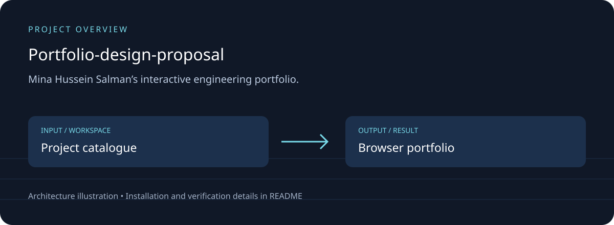
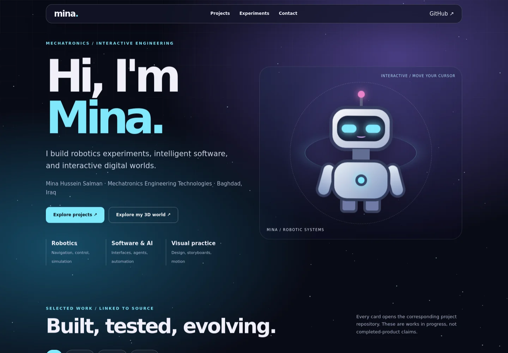

# Portfolio-design-proposal

## Download, setup and project overview

Mina Hussein Salman’s interactive engineering portfolio.

Project filters; linked repositories; responsive layout; animated robot and reduced-motion support.



### Running application



Actual local browser capture from this maintenance pass; a screenshot alone does not verify every feature.

[Download source ZIP](https://github.com/ahpa5246-lgtm/Portfolio-design-proposal/archive/refs/heads/main.zip) · [Changes and branches](https://github.com/ahpa5246-lgtm/Portfolio-design-proposal/branches) · [Verification notes](docs/QUALITY_REVIEW.md)

The ZIP contains source code. Installation steps and external runtime requirements are listed below.

```bash
git clone https://github.com/ahpa5246-lgtm/Portfolio-design-proposal.git
cd Portfolio-design-proposal
```

From the repository directory:

```text
python -m http.server 8080 --bind 127.0.0.1
# Open http://127.0.0.1:8080
```

The diagram is a project illustration. Test results and runtime limitations are recorded in [the review](docs/QUALITY_REVIEW.md); it is not a production-readiness certification.


Mina Hussein Salman’s interactive engineering portfolio.

Project filters; linked repositories; responsive layout; animated robot and reduced-motion support.
